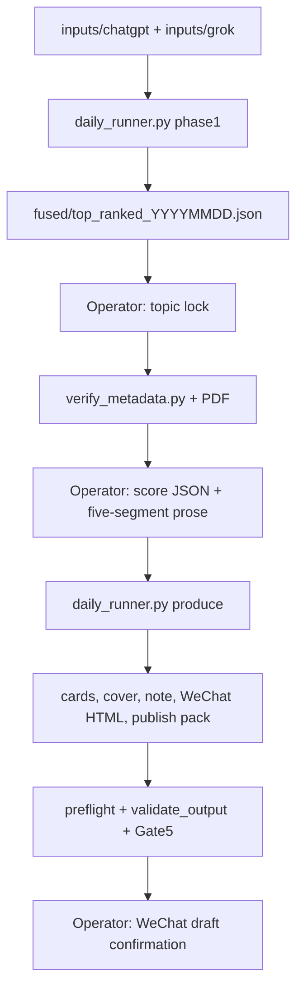

# Paper Notes

Daily B2B paper notes for a WeChat column. Operators lock the topic and write the five segments. Scripts assemble the pack and run gates we can re-check. A green gate does not publish the post.

[](https://opensource.org/licenses/MIT)
[](https://www.python.org/downloads/)

This repository does not record a before/after cycle time or a customer ROI figure. What changed is the handoff, and what we can show is the gate on each note.

## The loop

### Problem

A note used to cross several loose steps in one day: two source lists, a topic choice, a score, a PDF check, cards, HTML, and a last edit before WeChat. Experimental image scripts sat next to the release path, so a near-release run could pick the wrong chain. Hand-edited HTML could drift away from the JSON payload, and a folder could look finished while `affiliations` were empty or a placeholder string was still in the draft.

That split is written down in [`docs/PRODUCTION_BASELINE.md`](docs/PRODUCTION_BASELINE.md) and [`docs/DESIGN_RENDER_SEPARATION.md`](docs/DESIGN_RENDER_SEPARATION.md).

### What changed

We kept one release path: `scripts/production/`, `scripts/maintenance/`, and the `Makefile`. `scripts/production/daily_runner.py` is the production entry. It runs metadata verification, payload build, article render, cards, cover, publish pack, and preflight. The old experimental entry points under `scripts/` fail fast instead of writing over the formal images.

The live article is five segments: hook, judgment, evidence, boundary, landing. `render_article_wechat_safe.py --five-seg` writes those headings and leaves the prose empty. The older A–F outline in [`references/md_template.md`](references/md_template.md) is still how `daily_runner.py produce` accepts payload fields, and it remains for older notes. It is not the article shape validation expects on a five-segment draft.

Optional DeepSeek helpers (`make deepseek-candidates`, `make deepseek-payload`) draft JSON for discussion. They do not replace topic lock, PDF checks, the five-segment prose, or QA. See [`docs/DEEPSEEK_API_LAYER.md`](docs/DEEPSEEK_API_LAYER.md).

### Who does what

| Step | Who | What actually happens |
| --- | --- | --- |
| Topic lock | Operator | After phase 1, we dedupe against [`outputs/READY_INDEX.md`](outputs/READY_INDEX.md), skip papers already published, and lock an arXiv id that fits the day's theme. Rank order is not the decision. |
| Metadata and PDF | Script, then operator | `verify_metadata.py` pulls arXiv metadata and can keep the PDF. We read the first pages (title, authors, affiliations, abstract, category, date). Wrong affiliations go in `fused/<arxiv_id>_metadata_overrides.json` so a later produce does not drop them. |
| Score | Operator | Five dimensions, 0–2 each, total out of 10, one decimal: Impact, Novelty, Evidence, Applicability, Reusability. Written to `fused/<arxiv_id>_score.json`. |
| Five-segment writing | Operator | We write hook → judgment → evidence → boundary → landing into the skeleton. The renderer does not fill those paragraphs. A drafting pass is only a draft. |
| Pack and gates | Scripts | Cards, cover, `note.md`, `article_wechat_safe.html`, `publish_pack.md`, then preflight and QA. |
| Draft-box confirmation | Operator | We paste the checked HTML into the WeChat editor and confirm the draft there. Paste rules are in [`docs/WECHAT_PUBLISH_FORMAT.md`](docs/WECHAT_PUBLISH_FORMAT.md). |
| freepublish | Nobody, from this repo | There is no WeChat freepublish call here. Passing QA does not put the note live. After a person publishes, we record the link. |

### How we know

No hour count, throughput rate, or revenue figure is stored in the operator guide or elsewhere in this repo. A note is ready when the gates below are green.

| Gate | Command | What it holds |
| --- | --- | --- |
| Missing input | `make phase1 DATE=YYYYMMDD` | Stops with `FileNotFoundError` if `inputs/chatgpt/YYYYMMDD.txt` or `inputs/grok/YYYYMMDD.txt` is absent. The guide treats that as the correct fail-fast. The run does not invent candidates. |
| Preflight | `make preflight OUT_DIR=... MODE=publish` | Publish mode requires `cover_235.png`, `header_card.png`, `article_wechat_safe.html`, `note.md`, and `publish_pack.md`. Blocking findings include a missing file, placeholder strings (`待补充`, `TBD`, `placeholder`, and the other patterns in `preflight_check.py`), a WeChat HTML file that does not reference `header_card.png`, and empty `info.affiliations` (`affiliations_missing`). An `@` or an over-long affiliation is a warning (`affiliations_suspicious`). |
| Validation | `scripts/production/validate_output.py` (via `make qa`) | P0 fails QA. P1 and P2 stay on the report as editorial reminders. Five-segment HTML must contain the five headings, a source footnote, and a sibling `sales_card.md`. Evidence badges, a standalone glossary box, a sales card inside the article, or a hook that opens with `本文介绍` / `这篇论文` fail that check. |
| QA | `make qa OUT_DIR=... MODE=publish` | [`docs/OPERATOR_GUIDE.md`](docs/OPERATOR_GUIDE.md) states the fail condition as preflight blocking or validation P0. The script also runs Gate5, a checker that lives outside this repo (`wechat-gate5`). Gate5 blocking fails QA. If the Gate5 report is not produced, `make qa` errors instead of passing. |
| Platform wording | `make platform-precheck OUT_DIR=...` | Advisory scan. It does not block QA. The guide says the WeChat article still depends on the channel memo plus a semantic read. |
| Stale report | preflight warning `qa_report_stale` | An HTML edit after QA leaves an old PASS. We re-run `make qa` after editorial changes. The warning is a backstop, not the check. |

The release bar written in the operator guide is:

```text
PASS
blocking: 0
warning: 0
```

Image files are checked by operators against the pixels the scripts write: score and info cards 1080×720, cover 2350×1000 (`generate_cover.py`), header card 600×580 (`generate_cards.py`). Preflight checks that the publish files exist. It does not measure those dimensions itself. [`docs/HEADER_CARD_DESIGN.md`](docs/HEADER_CARD_DESIGN.md) still describes the header card as 600×585; the script is what gets written.

Claim-to-evidence rows in `evidence_ledger.json` (`claim_evidence_coverage`) are an observation-level P2 check in the guide, not a blocking gate.

### Daily pipeline

The day-to-day sequence — inputs, phase 1, topic choice, PDF check, score, produce, rebuild after affiliation fixes, preflight, editorial pass, QA — is [`docs/OPERATOR_GUIDE.md`](docs/OPERATOR_GUIDE.md). Use that file when reproducing a production day. The short command list below is only a map.

---

## Quick Start

### Install

```bash
pip install -r requirements.txt
```

Python 3.8+. Fonts used by the card scripts are in the repo (`SourceHanSansCN-Regular.otf`, `SourceHanSansCN-Bold.otf`).

### Daily commands

From [`docs/OPERATOR_GUIDE.md`](docs/OPERATOR_GUIDE.md). Replace the date, arXiv id, and copy with the note you locked.

```bash
make phase1 DATE=YYYYMMDD

python3 scripts/production/verify_metadata.py \
  --arxiv-id <arxiv_id> \
  --out fused/<arxiv_id>_metadata.json \
  --keep-pdf

pdftotext -f 1 -l 3 fused/<arxiv_id>_metadata.pdf - | sed -n '1,260p'

# Write fused/<arxiv_id>_score.json, then fill the five segments.
# produce still takes the older A–F payload fields. Their defaults include
# the placeholder 待补充, which publish preflight blocks, so pass real copy.
# The full flag list is in the operator guide.

python3 scripts/production/daily_runner.py produce \
  --date YYYYMMDD \
  --arxiv-id <arxiv_id> \
  --paper-key <short_key> \
  --title-cn "<short Chinese title>" \
  --score-json fused/<arxiv_id>_score.json \
  --out-dir outputs/ready/YYYYMMDD/<arxiv_id>

make preflight OUT_DIR=outputs/ready/YYYYMMDD/<arxiv_id> MODE=publish
make qa OUT_DIR=outputs/ready/YYYYMMDD/<arxiv_id> MODE=publish
```

`paper-key` is short ASCII (`omc`, `tool-attn`). It names payload files and the short label on the cover.

### Render cards from a payload

For a single pack, copy [`references/data_template.json`](references/data_template.json), then:

```bash
python3 scripts/production/generate_cards.py --data data.json --out outputs/my-paper
python3 scripts/production/generate_cover.py --data data.json --out outputs/my-paper/cover_235.png
```

`generate_cards.py` writes `header_card.png` (600×580), and also `score_card.png` and `info_card.png` (1080×720). Formal images stay on these two scripts. Do not swap in `scripts/experimental/` on a release day.

Score object inside the payload:

```json
{
  "paper_title": "Paper title",
  "score": {
    "total": 8.5,
    "dimensions": [
      {"label": "重要性 Impact", "value": 1.8},
      {"label": "创新性 Novelty", "value": 1.7},
      {"label": "可验证性 Evidence", "value": 1.6},
      {"label": "产业可用性 Applicability", "value": 1.7},
      {"label": "可复用性 Reusability", "value": 1.6}
    ]
  },
  "info": {
    "title": "English title",
    "title_cn": "中文短标题",
    "link": "https://arxiv.org/abs/XXXX.XXXXX",
    "authors": ["Author 1", "Author 2"],
    "affiliations": ["Institution A", "Institution B"]
  }
}
```

Each dimension is 0–2. The total is the sum, kept to one decimal, out of 10.

### Article outline

Current drafts use five segments. Validation looks for these headings in `article_wechat_safe.html`:

| Segment | Role |
| --- | --- |
| 一、钩子 | Scene, number, or question. Not “this paper introduces”. |
| 二、判断 | The claim, before the evidence. |
| 三、证据 | Figures inside sentences, in an order that builds. |
| 四、边界 | Limit, scope, or cost. Not a badge list. |
| 五、落点 | The claim again, plus one line a reader can take away. |

The A–F headings (research question, contributions, method, results, industry implications, verdict) are the payload slots and the older template. See [`references/md_template.md`](references/md_template.md).

---

## Outputs

A production directory is `outputs/ready/YYYYMMDD/<arxiv_id>/`. The operator guide lists the full bundle (payloads, evidence ledger, both card images, preflight, validation, and QA reports).

Publish-mode preflight requires `cover_235.png`, `header_card.png`, `article_wechat_safe.html`, `note.md`, and `publish_pack.md`. The card script also writes the two larger cards; preflight does not fail if those two are absent.

| File | Role |
| --- | --- |
| `header_card.png` | 600×580 banner used in the article. Required by publish preflight. |
| `score_card.png` | 1080×720 five-dimension card |
| `info_card.png` | 1080×720 title, link, authors, affiliations |
| `cover_235.png` | 2350×1000 cover (2.35:1). Required by publish preflight. |
| `note.md` | Markdown article. Required by publish preflight. |
| `article_wechat_safe.html` | WeChat HTML that QA reads. Required by publish preflight. |
| `publish_pack.md` | Titles, intro, summary, checklist. Required by publish preflight. |

`article_editor_ready.html` is still produced for the editor. The guide’s paste standard treats `article_wechat_safe.html` as the QA source and then drops blocks on purpose (top fragment, source-link block, footer, signature image). QA PASS does not mean every local block is pasted.

Samples: [`examples/`](examples/).

---

## Project structure

```
paper-notes/
├── references/          # Payload template, A–F markdown template, CSS
├── scripts/production/  # Release scripts (daily_runner, gates, renderers)
├── scripts/maintenance/ # Backfill and batch standardize
├── scripts/experimental/# Not on the release path
├── outputs/             # ready/ and historical packs
├── examples/            # Sample outputs
├── docs/                # Operator guide and baselines
├── assets/              # Logo and fonts
└── Makefile             # phase1, preflight, qa, and related targets
```

`make help` lists the targets.

---

## Customization

- **Editor CSS** — [`references/css_main.md`](references/css_main.md). Tokens used there:

```css
:root {
  --primary: #0052D9;
  --secondary: #E34D59;
  --bg: #F7F9FC;
  --text: #333333;
  --muted: #6B7280;
}
```

  `article_wechat_safe.html` does not read that stylesheet. Its colors are inline in `THEME` inside `scripts/production/render_article_wechat_safe.py`.
- **Score labels** — `score.dimensions` in the payload. Keep five dimensions, 0–2 each.
- **Older article template** — [`references/md_template.md`](references/md_template.md).

### Data flow



---

## License

MIT. See [LICENSE](LICENSE).

## Related

WeChat column “AI 系统笔记” (AI System Notes): the daily paper-note series this loop is built for.

---

## 中文摘要

英文正文在上面。这里只重复同一套事实，不另加周期或收益数字。

每天的 B2B 论文速记以前散在候选、选题、评分、PDF、出图、HTML 和临发布修改上。实验图片脚本和正式链放在一起，手改 HTML 会和 payload 漂移，空单位或占位符也可能留在看起来已经完成的目录里。

现在正式路径只走 `scripts/production/`、`scripts/maintenance/` 和 `Makefile`。`daily_runner.py` 串起核验、payload、渲染、出图、发布包和 preflight。实验入口会直接失败，而不是盖掉正式图。

人手步骤：选题锁定（对照 `outputs/READY_INDEX.md`，不把排序当分）、五段正文（钩子、判断、证据、边界、落点；`--five-seg` 只出标题）、公众号草稿箱确认。本仓库没有 freepublish，QA 通过不会自动发布。

可复核的是门禁，不是耗时：缺输入时 phase1 失败；`make preflight` 在 publish 模式下查必备文件、占位符和空 `affiliations`；`make qa` 在 preflight blocking 或 validation P0 时失败，并会跑仓库外的 Gate5；`make platform-precheck` 只作提示。操作指南里的通过线是 `PASS`、`blocking: 0`、`warning: 0`。仓库里没有写生产周期缩短了多少。

日常步骤以 [`docs/OPERATOR_GUIDE.md`](docs/OPERATOR_GUIDE.md) 为准。安装和命令见上面的 Quick Start。

---

## Sponsor

If this project helps you:

**WeChat** (QR in `assets/wechat-reward.png`). Suggested amounts: ¥9.9 / ¥49 / ¥199.

**PayPal:** [https://paypal.me/aisystemnotes](https://paypal.me/aisystemnotes). Suggested amounts: $1.99 / $9.99 / $49.99.
